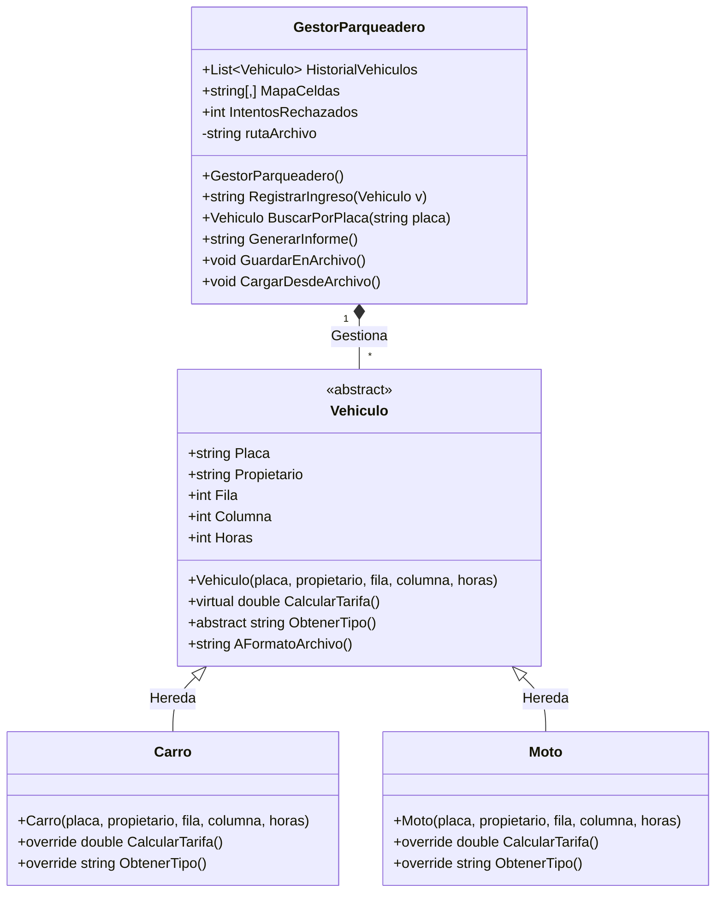

# ParkControl C# - Sistema de Gestión de Parqueadero

**Autora:** Vanessa Correa

Aplicación de escritorio desarrollada en **C# (Windows Forms 100% por código)** para administrar el ingreso, ubicación, búsqueda rápida, cálculo de tarifas y reportes estadísticos de un parqueadero.

## Problema que resuelve
Automatiza el control operativo de un parqueadero de 3 pisos y 4 puestos por piso (12 celdas), eliminando errores manuales en el cobro según el tipo de vehículo (Carro o Moto), evitando la doble asignación de puestos o placas duplicadas y conservando el historial de registros en un archivo de texto plano.

## Funcionalidades Principales
1. **Registro y Validación de Ingresos:** Valida campos obligatorios (`ErrorProvider`), placas duplicadas y disponibilidad en matriz (`string[3,4]`).
2. **Búsqueda Rápida por Placa:** Localiza vehículos activos al instante mediante ciclo y bandera mostrando propietario, ubicación y tarifa.
3. **Cálculo Automático de Tarifas (Polimorfismo):** Carros liquidan `$3.500/hora + $1.000` de recargo y Motos `$1.800/hora`.
4. **Informe Estadístico del Turno:** Resume total de vehículos, recaudos, intentos rechazados y alerta de cupo lleno.
5. **Persistencia en Archivo Plano:** Guarda y restaura los datos automáticamente desde `datos_parqueadero.txt`.

## Diagrama UML de Clases



## Cómo ejecutar el proyecto
1. Clonar el repositorio:
   ```bash
   git clone [https://github.com/yudy65/GestionParqueadero-CSharp.git](https://github.com/yudy65/GestionParqueadero-CSharp.git)
   ```
2. Entrar a la carpeta del proyecto:
   ```bash
   cd GestionParqueadero-CSharp/ParqueaderoApp
   ```
3. Ejecutar la aplicación:
   ```bash
   dotnet run
   ```